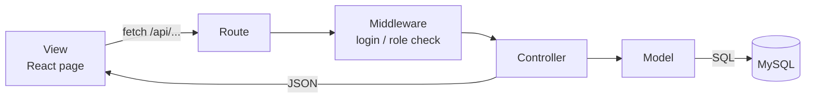

# ⚖️ Law Firm Management System

A web-based legal service platform that connects clients with qualified lawyers. CSE470 (Software Engineering) project, built with **React + Node.js/Express + MySQL** using the **MVC** pattern.

The full feature list is in [`docs/Law_Firm_Management_System.md`](docs/Law_Firm_Management_System.md).

## Features implemented so far

| # | Feature | What works |
|---|---------|-----------|
| 1 | **User Authentication** | Register and log in as a client or lawyer (plus admin login). Passwords are hashed with bcrypt, sessions use a secure cookie, and each role gets its own dashboard and permissions. |
| 7 | **Document Management** | Clients and lawyers upload documents to a case (contract, evidence, court notice, legal form or other), view images, download files and delete their own uploads. Files are served only to the client and lawyer on that case. |
| 8 | **Appointment Scheduling** | Lawyers set weekly office hours (3–6 days, Fridays off, 7 slots a day). Clients book a free slot on a case. Lawyers can accept, reject, reschedule or complete an appointment. Booked slots are locked, so appointments can never overlap. |
| 9 | **Admin Panel & Lawyer Verification** | Admins review new lawyer registrations and their uploaded ID/certificate, then approve or reject them. The panel records the approving admin and the date. Only verified lawyers can take appointments. |

## Tech stack

| Layer | Technology |
|-------|------------|
| **View** | React 18 (Vite), React Router, Chart.js |
| **Controller** | Node.js + Express 5 |
| **Model** | MySQL (via `mysql2`) |
| Auth | `express-session`, `bcryptjs` |
| Uploads | `multer` (files stored in `server/uploads/`) |

## MVC structure

| Part | Folder | Responsibility |
|------|--------|----------------|
| **Model** | [`server/src/models/`](server/src/models) | One file per table. All SQL lives here. |
| **View** | [`client/src/pages/`](client/src/pages), [`client/src/components/`](client/src/components) | React screens. They only talk to the API. |
| **Controller** | [`server/src/controllers/`](server/src/controllers) | Validate input, check permissions, call models, return JSON. |
| Routes | [`server/src/routes/`](server/src/routes) | URL + method → controller function. |
| Middleware | [`server/src/middleware/`](server/src/middleware) | Login/role guards, uploads, error handling. |



**Example: a lawyer reschedules an appointment.** `Appointments.jsx` (View) sends `PATCH /api/appointments/5/reschedule` → `appointmentRoutes.js` only lets lawyers through → `appointmentController.reschedule()` checks that the appointment belongs to this lawyer and that the new slot is one they work and nobody has booked → `Appointment.reschedule()` (Model) updates MySQL → the View shows a toast and reloads the table.

## Project structure

```
Lawfirm-CSE470/
├── package.json            # Scripts to install and run everything
├── database/law_firm.sql   # Schema + sample data
├── docs/                   # Feature specification
├── server/                 # Express API (Models + Controllers)
│   ├── server.js
│   ├── .env.example
│   └── src/
│       ├── app.js
│       ├── config/db.js
│       ├── models/         # User, Client, Lawyer, Case, Appointment, Availability, Document
│       ├── controllers/    # auth, dashboard, admin, schedule, appointment, document
│       ├── routes/
│       ├── middleware/
│       └── utils/
└── client/                 # React app (Views)
    └── src/
        ├── pages/          # Landing, Login, Register, Dashboard, AdminDashboard,
        │                   # Schedule, Appointments, DocumentCases, Documents
        ├── components/     # Navbar, route guards, charts, shared UI
        ├── context/        # logged-in user, toasts
        ├── api/            # fetch wrapper
        └── styles/
```

## Getting started

**You need:** [Node.js](https://nodejs.org/) 18+ and MySQL/MariaDB. With [XAMPP](https://www.apachefriends.org/), start only **MySQL**.

1. **Create the database.** In phpMyAdmin go to **Import** and choose `database/law_firm.sql`, or run `mysql -u root -p < database/law_firm.sql`.
   > ⚠️ The script drops any existing `law_firm` database first.
2. **Configure the server:** `cp server/.env.example server/.env`. The defaults match XAMPP (user `root`, no password).
3. **Install and run:**
   ```bash
   npm run install:all
   npm run dev
   ```
4. Open **<http://localhost:5173>**.

For a production build, run `npm run build` and then `npm start`, and open <http://localhost:5000>.

## Demo accounts

| Role | Username | Password |
|------|----------|----------|
| Admin | `admin` | `admin123` |
| Client | `john_doe`, `ayesha_r`, `karim_u` | `password123` |
| Lawyer | `sarah_khan`, `rafiq_ahmed`, `nadia_islam` | `password123` |

The sample data includes three cases a lawyer has already accepted:

| Client | Lawyer | Case |
|--------|--------|------|
| John Doe | Sarah Khan | Property Dispute in Gulshan |
| Ayesha Rahman | Rafiq Ahmed | Supplier Contract Breach |
| Karim Uddin | Nadia Islam | Inheritance Settlement |

These let you try documents and appointments straight away. Each sample lawyer also has a weekly schedule.

**Try it:**
1. Log in as `john_doe` → **Appointments** → book a slot with Sarah Khan.
2. Log in as `sarah_khan` → **Appointments** → accept, reject or reschedule it.
3. Both users can upload documents under **Documents**.
4. Register a new lawyer, then log in as `admin` to approve or reject them.

## API

All endpoints are under `/api` and return JSON.

| Method | Endpoint | Who | Purpose |
|--------|----------|-----|---------|
| POST | `/auth/register` | public | Register (multipart; lawyers upload `verification_doc`) |
| POST | `/auth/login` | public | `{ username, password, role }` |
| POST | `/auth/logout` | any | Log out |
| GET | `/auth/me` | any | Current user or `null` |
| GET | `/dashboard/lawyer` | lawyer | Profile and verification status |
| GET | `/dashboard/admin` | admin | Charts, pending lawyers, verification history |
| PATCH | `/admin/lawyers/:lawyerId/verification` | admin | `{ action: approve \| reject }` |
| GET | `/admin/lawyers/:lawyerId/document` | admin | View a lawyer's uploaded ID/certificate |
| GET / PUT | `/schedule` | lawyer | Read / save weekly availability |
| GET | `/appointments` | client, lawyer | Appointments + cases you can book on |
| GET | `/appointments/slots?case_id=&date=` | client, lawyer | Free and booked slots for a day |
| GET | `/appointments/slots?appointment_id=&date=` | lawyer | Slots for rescheduling |
| POST | `/appointments` | client, lawyer | Book `{ case_id, appointment_date, session_slot, notes }` |
| PATCH | `/appointments/:appointmentId` | lawyer | `{ action: accept \| reject \| complete }` |
| PATCH | `/appointments/:appointmentId/reschedule` | lawyer | `{ appointment_date, session_slot }` |
| GET | `/documents/cases` | client, lawyer | Your cases that can hold documents |
| GET / POST | `/cases/:caseId/documents` | client, lawyer | List / upload (`document_type`, `document`) |
| GET | `/documents/:documentId/file` | client, lawyer | View, or `?download=1` to download |
| DELETE | `/documents/:documentId` | uploader | Delete your own upload |
